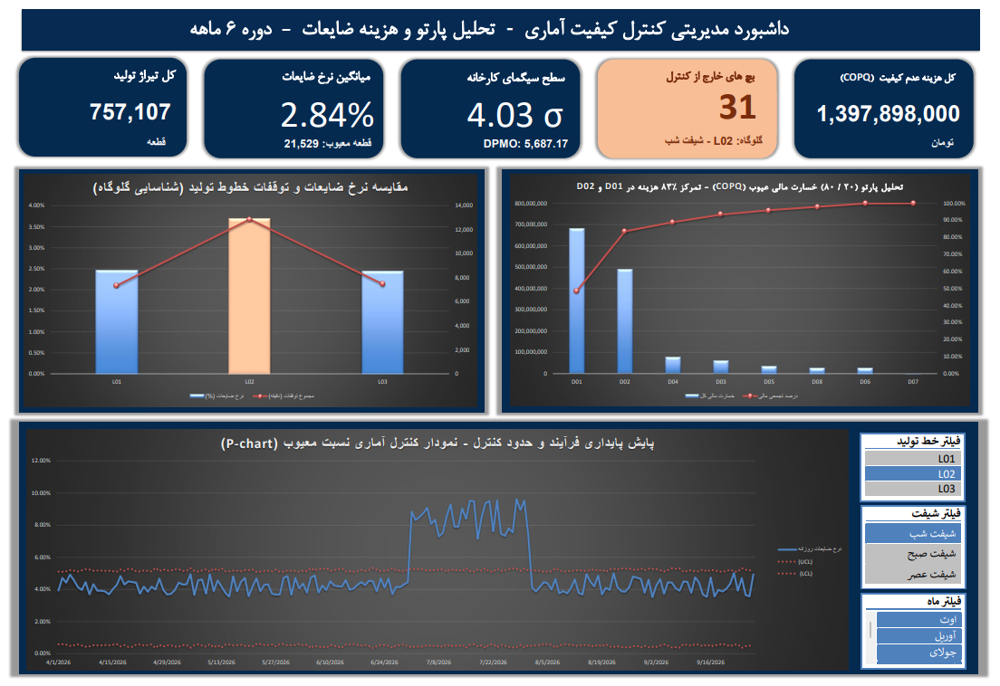

# 📊 داشبورد تحلیل کنترل کیفیت آماری (SPC) و هزینه ضایعات — Excel و Power Query

پروژه تحلیلی مستقل در حوزه مهندسی کیفیت و تحلیل داده صنعتی؛ شبیه‌سازی و تحلیل ۶ ماه داده تولید و بازرسی کیفیت یک کارخانه با ۳ خط تزریق پلیمری (**۱٬۶۲۰ بچ** معادل **۷۵۷٬۱۰۷ قطعه** در ۳ شیفت کاری). کل فرآیند از پاک‌سازی داده خام در **Power Query** تا مدل‌سازی و ساخت داشبورد مدیریتی در **Excel** پیاده‌سازی شده است.

## 🛠 اقدامات انجام‌شده
- پاک‌سازی داده‌های خام در Power Query و ساختاردهی جداول در قالب مدل ستاره‌ای (`Fact` و `Dim`)
- پیاده‌سازی نمودار کنترل `P-Chart` با حدود کنترل متغیر ۳ سیگما (متناسب با اندازه بچ‌های غیرثابت)
- محاسبه شاخص‌های شش سیگما: `DPMO` و سطح سیگما (با فرض شیفت ۱.۵ سیگما و ۵ مشخصه CTQ برای هر قطعه)
- تحلیل پارتو از دو زاویه تعدادی و مالی همراه با کلاس‌بندی `ABC`
- ساخت مدل هزینه عدم کیفیت (`COPQ`) و تحلیل سناریو (`What-If`) برای برآورد صرفه‌جویی مالی بهبودها
- طراحی داشبورد مدیریتی شامل نمای کلی KPIها و پارتو در سطح کل کارخانه + نمودار تعاملی `P-Chart` با سه فیلتر خط، شیفت و ماه

## 📈 یافته‌های کلیدی
- **وضعیت کلی فرآیند:** میانگین نرخ ضایعات **۲.۸۴٪**، معادل `DPMO = 5,687` و سطح سیگمای **4.03**
- **شناسایی گلوگاه:** هر **۳۱ بچِ خارج از کنترل** در «خط ۲ - شیفت شب» رخ داده‌اند؛ گلوگاه توقفات هم همین‌جاست (**۷٬۷۶۸ دقیقه** توقف، یعنی ۶۰٪ از کل ۱۲٬۸۶۴ دقیقه توقف خط ۲). علاوه بر بحران ماه جولای، این شیفت در روزهای عادی نیز نرخ ضایعات مزمن **۴.۲۱٪** دارد (در برابر ۳.۰۵٪ شیفت صبح و عصر همین خط)
- **تمرکز خسارت (پارتو):** دو عیب اول (`D01` تاب‌برداشتگی حرارتی و `D02` تزریق ناقص) عامل **۸۳.۵٪** از کل **۱,۳۹۷,۸۹۸,۰۰۰ تومان** خسارت عدم کیفیت هستند
- **پتانسیل بهبود:** با ۲۰٪ کاهش همین دو عیب کلاس A، ماهانه حدود **۳۸.۹ میلیون تومان** صرفه‌جویی مالی ایجاد می‌شود، **۳٬۱۱۸ قطعه سالم** در دوره ۶ ماهه آزاد می‌شود و سطح سیگمای کارخانه به **4.09** می‌رسد

## 🗂 درباره داده‌ها و معماری فایل
- دیتاست پروژه شبیه‌سازی‌شده است و عمداً با خطاهای رایج داده‌های صنعتی طراحی شده (۹ نگارش مختلف برای نام شیفت، بچ‌های تکراری، ردیف‌های خالی و تاریخ متنی) تا فرآیند واقعی ETL پیاده‌سازی شود.
- پاک‌سازی در Power Query شامل `Trim`، استانداردسازی مقادیر، حذف تکراری‌ها و یک مرحله میانی `Group By + Merge` روی `Batch_ID` است تا هنگام ادغام با جدول عیوب، خطای چندبرابر شدن تیراژ تولید رخ ندهد.
- فایل کاملاً خودکفاست؛ همه کوئری‌ها به جداول داخل خود فایل متصل‌اند و روی هر سیستمی با `Refresh All` بدون خطای مسیر به‌روز می‌شوند.
- شیت‌های داده خام و جداول مدل داده (`Fact` و `Dim`) برای تمیزی محیط کار مخفی شده‌اند و با `Unhide` قابل مشاهده‌اند.

## 📁 فایل‌ها
| فایل | توضیح |
|---|---|
| `Quality_Analytics_Dashboard.xlsx` | فایل کامل اکسل  |
| `Quality_Analytics_Dashboard.pdf` | خروجی PDF داشبورد در یک صفحه |

